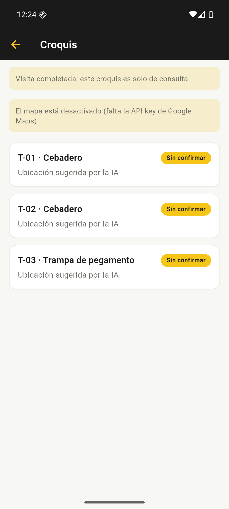

# Evidencias de habilitación y prueba de Android

Responsable de la preparación y comprobación: Juan Bórquez. Ejecución original:
21 de octubre de 2026. Publicación documental en la rama `juan`.

## Alcance y procedencia

Se preparó Android para ejecutar la aplicación Flutter existente, sin crear
otra implementación ni atribuir a esta tarea el desarrollo original de la app
móvil. El código compartido de pantallas, recursos y dependencias se mantuvo
igual a la base integrada que incluye `76aae16`. La configuración específica
de desarrollo Android quedó registrada después en `4a8a868`.

Las imágenes son las siete capturas originales tomadas durante esa ejecución
local; se copiaron sin edición y se verificó que sus hashes coincidieran con
los archivos de origen. Se revisaron visualmente antes de incorporarlas.
Muestran la cuenta y datos de demostración existentes, no una validación del
cliente. No contienen tokens ni contraseñas legibles.

El [manifiesto SHA-256](SHA256SUMS.txt) permite detectar cambios posteriores
en las imágenes; por sí solo no certifica la fecha ni el resultado de una prueba.
No se recrearon pantallas ni se generaron capturas de resultados no ejecutados.

## Entorno y compilación registrados

| Elemento | Valor de la ejecución |
| --- | --- |
| Aplicación | `com.killbichosia.app_movil`, versión `1.0.0+1`, variante debug |
| Flutter / Dart | 3.47.5 / 3.13.4 |
| Java | Temurin JDK 17.0.20.1 |
| Dispositivo | Emulador `KillBichos_API36`, perfil Pixel 7, Android 16 / API 36, x86_64 |
| Backend | Local, accedido mediante `http://10.0.2.2:8000` |
| Mapa | `MAPS_ENABLED=false`: sin clave Android autorizada |
| Zona configurada | `America/Santiago` |
| Escrituras funcionales | No se crearon ni editaron clientes, visitas o trampas durante la comprobación |

Comando de la compilación documentada, desde `app-movil`:

```powershell
flutter build apk --debug --no-pub --dart-define=API_BASE_URL=http://10.0.2.2:8000 --dart-define=MAPS_ENABLED=false
```

El APK generado se conserva localmente en
`app-movil/build/app/outputs/flutter-apk/app-debug.apk`; no se sube a Git.
SHA-256 comprobado nuevamente al incorporar estas evidencias:

```text
1c3e0b860ae60bc59c5ab895bc447158b8f8a2a934d2f0efb876907c951db92c
```

La [guía Android](../../app-movil/ANDROID.md) registra resolución de dependencias
con lockfile, análisis sin observaciones y **16 pruebas Flutter existentes
aprobadas** en la preparación original. No se repitieron al publicar estas
capturas ni se conserva en este paquete un log primario de esas 16 pruebas.
Por tanto, esa cifra es un resultado registrado en la guía, no una nueva
ejecución automatizada ni 16 pruebas funcionales en el emulador.

## Casos y evidencia visual

| ID | Comprobación original | Resultado y límite | Captura |
| --- | --- | --- | --- |
| AND-E01 | Abrir el APK instalado | Se presenta el formulario de ingreso; no prueba credenciales inválidas | [Login](capturas/arranque.png) |
| AND-E02 | Iniciar sesión y consultar agenda | Acceso correcto al backend local; agenda sin visitas para el día, no agenda poblada | [Agenda](capturas/login-result.png) |
| AND-E03 | Consultar historial | Se muestra una visita completada de demostración con tres trampas | [Historial](capturas/historial.png) |
| AND-E04 | Abrir el detalle de esa visita | Estado completada y acceso al croquis; no se comprueba edición | [Detalle](capturas/visita.png) |
| AND-E05 | Abrir croquis existente | Tres trampas en solo consulta y aviso explícito de mapa desactivado | [Croquis](capturas/croquis.png) |
| AND-E06 | Forzar cierre y relanzar con sesión vigente | Se vuelve a la agenda sin ingresar credenciales; no se prueba renovación de token vencido | [Sesión restaurada](capturas/sesion-restaurada.png) |
| AND-E07 | Cerrar sesión, forzar cierre y relanzar | Se vuelve al formulario de login; no implica reinicio completo del dispositivo | [Logout y relanzamiento](capturas/logout-reinicio.png) |

Una captura es el estado visible final; no registra por sí sola cada acción
anterior. Los pasos de sesión corresponden a la comprobación manual descrita
en la guía. Las horas de la barra del emulador difieren entre imágenes: durante
la preparación se ajustó su zona horaria; no deben usarse para reconstruir una
cronología exacta.

El texto «Ubicación sugerida por la IA» de las trampas pertenece a los datos de
demostración consultados. Esta prueba no invocó un modelo ni valida la generación
de nuevas sugerencias por IA.

### Croquis consultado en Android



## Límites y pendientes

- Falta autorizar la clave de Maps SDK for Android para el paquete y certificado
  correspondientes, y probar mapa real, marcadores y selección.
- Falta probar GPS, permisos, cámara, galería y fotos privadas en Android.
- Faltan los flujos de escritura con datos aislados, credenciales inválidas,
  recuperación sin red y renovación de token vencido.
- Falta comparar con el iPhone usando el mismo commit, configuración y datos.
  El código compartido no acredita equivalencia funcional completa.
- Falta comprobar un dispositivo físico y un reinicio completo del dispositivo.
- Es un APK debug: no constituye una versión release ni una publicación en tienda.
- Estos resultados no validan cambios incorporados después de la compilación
  original ni sustituyen la suite de backend o la aceptación del cliente.

No se suman las siete capturas como siete pruebas automatizadas ni se suman
las 16 pruebas Flutter a las suites del panel como si fueran una sola ejecución.

## Verificar la integridad de las capturas

Desde esta carpeta, en PowerShell:

```powershell
$ErrorActionPreference = 'Stop'
Get-Content -LiteralPath 'SHA256SUMS.txt' | ForEach-Object {
    $parts = $_ -split '  ', 2
    $actualHash = (Get-FileHash -LiteralPath $parts[1] -Algorithm SHA256).Hash.ToLowerInvariant()
    if ($actualHash -ne $parts[0]) { throw "Hash distinto: $($parts[1])" }
}
Write-Output 'Las siete capturas coinciden con el manifiesto SHA-256.'
```
