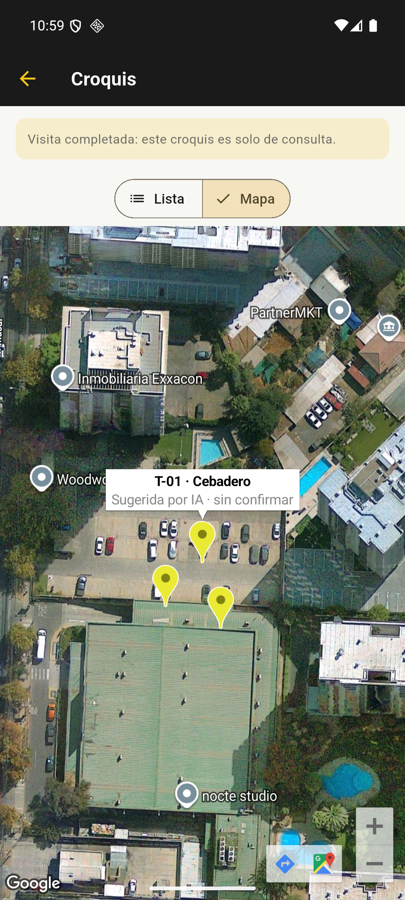

# Android con Google Maps — verificación del 22/10/2026

Responsable: Juan Bórquez. Entorno Windows y emulador local. Horas del informe
en `America/Santiago`; los JSON HTTP registran UTC, que en esta ejecución
corresponde al 23/10 UTC y al 22/10 en Chile.

## Resultado y alcance

Se generó e instaló un **APK debug con Maps habilitado**. Se comprobó el mapa
híbrido/satelital real de Google, tres marcadores y la ventana informativa de
T-01. También se verificaron login, logout, historial, consulta del croquis y
persistencia de sesión vigente al cerrar forzosamente y relanzar la aplicación.

Flutter aprobó **18 pruebas existentes** y el análisis estático no encontró
observaciones. Una comprobación HTTP separada aprobó **12/12 casos** del backend.
Las comprobaciones manuales del emulador no se agregan a ninguno de esos totales.
No se suma esta ejecución a las suites históricas como pruebas distintas.

Esto deja una versión local de pruebas, no una entrega release ni una
certificación de todos los flujos de terreno o de equivalencia con el iPhone.

## Código, compilación y configuración

| Elemento | Comprobación |
| --- | --- |
| Rama | Solo `juan`; se integró `origin/main` en `61cfa00` |
| Referencia de main integrada | `fa86264` al preparar esta compilación |
| Código compartido | `lib/`, iOS y dependencias versionadas iguales a main; no se creó una segunda app |
| Herramientas | Flutter 3.47.5 / Dart 3.13.4, JDK 17.0.20.1, SDK Android API 36 |
| Emulador | `KillBichos_API36`, Android 16 / API 36, Google APIs x86_64 |
| APK | `com.killbichosia.app_movil`, versión `1.0.0+1`, min API 24, destino API 36, debug |
| Backend incorporado | `http://10.0.2.2:8000` para este emulador |
| Interruptor | `MAPS_ENABLED=true` |
| Clave Android | Leída de `android/secrets.properties`, ignorado por Git; coincide con la incorporada al manifiesto del APK |
| Clave iOS | Archivo privado configurado, pero no se compiló ni probó iOS en Windows |

En el `.env` raíz se encontró la clave de Maps web, no variables móviles.
Las claves móviles se leyeron de sus archivos privados existentes; no se
copiaron a plantillas `.example` ni se habilitó una lectura automática del
`.env` por Flutter.

Comando ejecutado desde `app-movil`:

```powershell
flutter build apk --debug --no-pub --dart-define=API_BASE_URL=http://10.0.2.2:8000 --dart-define=MAPS_ENABLED=true
```

El APK se encuentra localmente en
`app-movil/build/app/outputs/flutter-apk/app-debug.apk`, fuera del seguimiento
de Git. SHA-256:

```text
718aee538d50f2ed36a60ce3d236d901e339eba79cd873d621bf744a4a18b26d
```

Firma verificada con `apksigner`. Se conserva el SHA-1 debug autorizado para
esta preparación:

```text
6F:DB:6F:0A:46:B7:49:35:D7:7A:68:62:1F:7A:D5:44:81:2A:50:25
```

La inspección de las entradas descomprimidas del APK no encontró los valores
locales de OpenAI, JWT, Maps web ni Maps iOS. La clave Maps Android sí debe
estar en el APK para que el SDK funcione; requiere las restricciones adecuadas
de paquete, certificado y API. Esta inspección no es una auditoría exhaustiva.
Ver [resultado sin valores de claves](logs/apk_secret_check.json).

## Backend y base de datos

La base existente `killbichos_db` pertenece al proyecto Compose antiguo
`database`. Se conservó ese contenedor, sus redes y sus volúmenes. No se ejecutó
`down -v`, no se reinicializó la base y no se levantó un segundo servicio db.

Antes de migrar se generó un respaldo `pg_dump` en formato custom, conservado
solo fuera de Git. Se aplicó `migracion_message_sid.sql` en una transacción con
límites de espera, añadiendo `mensajes_whatsapp.message_sid`. Se comprobó además
que `dispositivos_trampa.foto_path` ya existe.

Se reconstruyó el backend y se inició mediante:

```powershell
docker compose build backend
docker compose up -d --no-deps --no-build backend
```

Los **18 archivos Python** de la aplicación del contenedor coinciden con el
código local al normalizar saltos de línea. Se comprobaron health y presencia
de `/auth/refresh` y `/croquis/{visit_id}/sugerencia`. No se invocó la generación
real por IA ni se enviaron mensajes de WhatsApp.

## Evidencias automatizadas

| Verificación | Resultado | Log original seleccionado |
| --- | --- | --- |
| Dependencias con lockfile | Correcto, sin actualizar versiones | [pub get](logs/flutter_pub_get.log) |
| Análisis Dart/Flutter | Sin observaciones | [analyze](logs/flutter_analyze.log) |
| Suite Flutter existente | 18 aprobadas | [flutter test](logs/flutter_test.log) |
| Compilación APK debug con Maps | Correcta | [build](logs/flutter_build_apk.log) |
| Backend HTTP | 12/12: health, contrato, login válido/inválido, refresh válido/inválido, rechazo de access como refresh, agenda, historial, visita, croquis y agenda anónima | [JSON HTTP](logs/backend_smoke.json) |
| Código del contenedor | 18 archivos coinciden, 0 diferencias | [JSON de comparación](logs/backend_source_check.json) |
| SDK de Maps | Inicialización observada; sin coincidencias de errores de autorización, FATAL EXCEPTION o E/flutter en la consulta filtrada | [inicio del SDK](logs/maps_logcat_redacted.log), [conteos del buffer consultado](logs/maps_runtime_check.json) |

Las pruebas HTTP usan la cuenta y datos de demostración existentes. Login y
refresh emiten tokens solo en memoria; no se guardan en los JSON. No se crearon
ni editaron clientes, visitas o trampas. La suite Flutter no equivale a 18
pruebas funcionales del emulador, y la comprobación HTTP no es extremo a extremo
con la interfaz Android.

## Comprobaciones manuales del emulador

| ID | Caso | Resultado y evidencia |
| --- | --- | --- |
| AND22-01 | Inicio tras instalar el APK actualizado | Entró con sesión previa vigente; apareció una incidencia de System UI, descrita abajo |
| AND22-02 | Historial y visita completada | Consulta correcta de la visita demo y sus tres trampas; [historial](capturas/03_historial.png) |
| AND22-03 | Mapa real | Se descargaron imágenes híbridas/satelitales y se mostraron tres marcadores; [mapa cargado](capturas/06_mapa_cargado.png) |
| AND22-04 | Selección de trampa | Al tocar T-01 se mostró nombre y estado; [marcador seleccionado](capturas/07_marcador.png) |
| AND22-05 | Solo consulta | La visita completada conserva el aviso y no presenta acciones para añadir, confirmar o mover trampas |
| AND22-06 | Cierre de sesión | Regresa al formulario; [logout](capturas/08_logout_login.png) |
| AND22-07 | Login válido desde la app | Regresa a la agenda vacía del día; [login correcto](capturas/09_login_correcto.png) |
| AND22-08 | Forzar cierre y relanzar | Conserva la sesión vigente; segundo arranque `Status: ok`; [sesión restaurada](capturas/10_sesion_restaurada.png) |

Los textos de sugerencia IA de las trampas pertenecen a datos ya existentes;
no prueban una nueva llamada al modelo. La ubicación del emulador no se usó
para agregar trampas. El mapa se dejó abierto al finalizar para revisión local.

### Mapa y selección comprobados



### Incidencias conservadas, no ocultadas

- En el primer arranque, con poca RAM disponible, Android mostró «System UI
  isn't responding». Se eligió Wait y el sistema se recuperó. El aviso era de
  System UI, no un FATAL EXCEPTION de la aplicación. Se conserva la
  [captura original](capturas/01_arranque.png). La primera espera de
  `am start -W` terminó en timeout; luego la app mostró sus pantallas y el
  siguiente arranque devolvió `Status: ok`.
- El mapa mostró inicialmente un fondo gris durante la carga del SDK y las
  imágenes. Se conserva esa [captura inicial](capturas/05_mapa_real.png), que
  no se considera una aprobación del mapa. La aprobación corresponde a las
  capturas posteriores con imágenes y marcadores visibles.
- La compilación advirtió sobre KGP de `package_info_plus` y versiones del XML
  del SDK. Terminó correctamente. No se actualizaron dependencias para ocultar
  los avisos. El SDK de Maps utilizó el renderer LEGACY del emulador.
- Para reducir consumo de memoria, se detuvo el daemon Gradle después de
  compilar y se abrió el emulador con 1536 MB y dos núcleos. No se cerraron
  aplicaciones del usuario ni se apagó la base de datos.

## Límites de la entrega

Siguen pendientes GPS y permisos, cámara y galería, carga/consulta de fotos
desde Android, flujos de escritura, recuperación sin conexión, renovación
automática de un token vencido desde la UI, teléfono físico y comparación con
el iPhone instalado. El refresh HTTP aprobado no cubre por sí solo todos esos
flujos. No se validó la generación real de IA ni WhatsApp desde este computador.

El APK solo alcanza el backend local mediante la dirección especial del
emulador. No debe entregarse así a un teléfono de la empresa: necesitará un
backend accesible, preferiblemente HTTPS, y una compilación con esa URL.
La variante release actual todavía requiere una firma de producción propia.
Los secretos JWT de ejemplo ya identificados no se consideran configuración
apta para una publicación productiva.

Las capturas se copiaron sin edición y sus hashes coinciden con los originales.
El [manifiesto SHA-256](SHA256SUMS.txt) permite verificar integridad, no certificar
por sí solo la fecha o ejecución. No se incluyen APK, backups SQL, `.env`,
archivos privados de claves ni tokens en este paquete.
