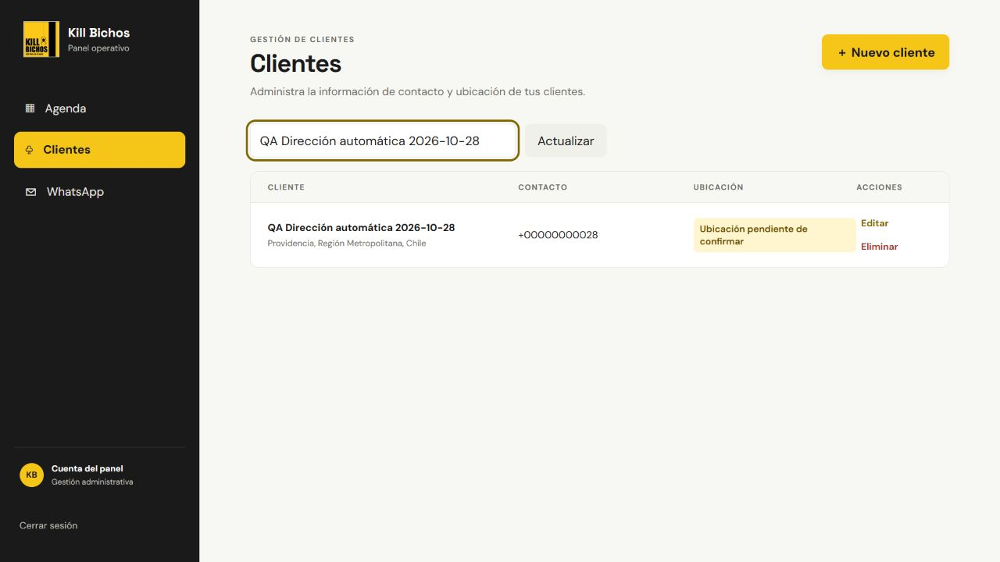

# Ubicación pendiente — 28/10/2026

Corrección sobre `738023f`, rama `juan`, destinada a la PR #25. Este registro
acredita las comprobaciones locales descritas; no acredita una prueba física
del APK nuevo.

## Comportamiento

- Android sin ubicación del cliente ni trampas válidas: muestra «Sin ubicación
  registrada», instrucciones para corregir la dirección y ningún mapa ficticio.
- Con trampas válidas y sin ubicación del cliente: mapa de trampas con aviso fijo.
- Se mantiene capturar por GPS; marcar en mapa requiere una referencia real.
- Clientes del panel mantiene una etiqueta amarilla «Ubicación pendiente de
  confirmar». Una dirección confirmada vuelve a mostrar sus coordenadas.
- Se rechazan coordenadas no finitas o fuera de rango al elegir puntos del mapa.

## Verificación automatizada

| Comprobación | Resultado | Registro |
|---|---|---|
| Flutter tests con Maps activo y API Wi-Fi | 164/164 | [flutter_test.log](flutter_test.log) |
| Flutter analyze | Sin incidencias | [flutter_analyze.log](flutter_analyze.log) |
| Frontend tests | 130/130 | [frontend.log](frontend.log) |
| Frontend producción | Compilación correcta | [frontend_build.log](frontend_build.log) |
| APK debug | Compilación correcta | [flutter_build.log](flutter_build.log) |

Los tests Flutter incluyen ausencia de mapa sin puntos, trampas con aviso,
cliente ubicado, texto ampliado, pantalla de croquis y disponibilidad de GPS.
Son pruebas automatizadas de widgets/servicios; no equivalen a un Redmi físico.

## Prueba manual del panel local

Se utilizó exclusivamente «QA Dirección automática 2026-10-28», con teléfono
sintético y una dirección de ejemplo pública. Se guardó una dirección genérica
de Providencia y se observó ubicación pendiente. Tras ir a Agenda y volver a
Clientes, el mensaje temporal ya no estaba, pero la etiqueta permanecía.
Después se restauró Avenida Providencia 1208 y se comprobó recuperación de las
coordenadas. No se editaron los datos de Pedro Vergiu.

Solo se reconstruyó el contenedor `web`. No hubo cambios de backend, migraciones
ni borrado de datos en este corte.

## APK generado

- Archivo: `kill-bichos-PR25-ubicacion-pendiente.apk`, también copiado al Escritorio.
- Paquete: `com.killbichosia.app_movil`; versión `1.0.0`, código `3`.
- Tamaño: 168064020 bytes.
- SHA-256: `5F44DA0FA33C0736F3755BE8CF9CA30D05217A42C326D2024E4DCA8DDBF339DE`.
- Certificado debug SHA-1: `6F:DB:6F:0A:46:B7:49:35:D7:7A:68:62:1F:7A:D5:44:81:2A:50:25`.
- API: `http://192.168.1.12:8000`; `MAPS_ENABLED=true`.

Instalar como actualización sin desinstalar conserva los datos locales. El APK
y los archivos privados de configuración permanecen fuera de Git. Los avisos
de compatibilidad futura de Kotlin/SDK quedaron en el log; no impidieron compilar.

Juan confirmó el pin rojo en su Redmi usando el APK anterior. Falta validar
físicamente esta pantalla nueva, la franja sin conexión y el envío al recuperar
señal con este APK. El bloqueo por foto pendiente sigue siendo local al teléfono;
otro dispositivo o el panel pueden completar la visita.
